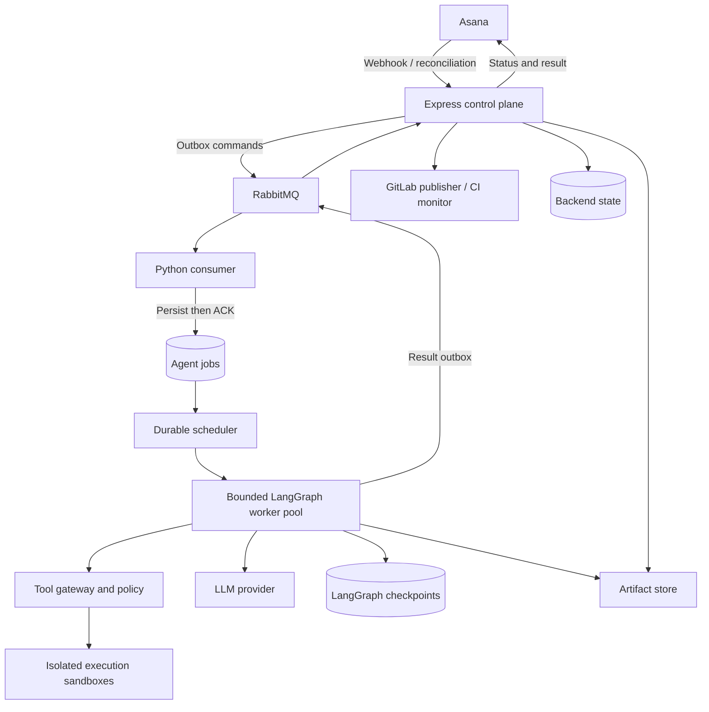
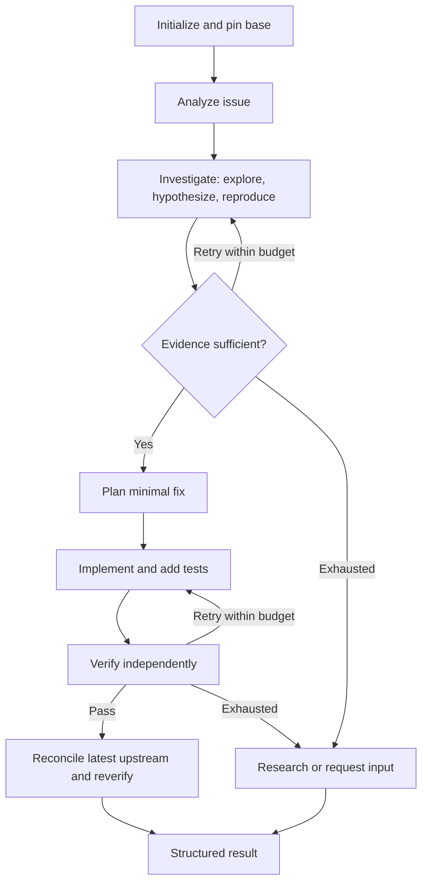

# Autonomous AI Software Engineer — High-Level Design

**Version:** 1.0 | **Date:** 2026-11-26 | **Status:** Architecture baseline; implementation and security validation pending

**Companion:** `requirements.md` (SRS). This document defines how the product is organized, not a claim of implemented capabilities. Detailed schemas, APIs and algorithms belong in LLD.

## 1. Goals and constraints

Build an evidence-driven software engineering agent that receives eligible Asana bugs, investigates a pinned GitLab revision, reproduces the failure, implements a minimal fix, verifies it and creates a merge request (MR) for human review. If evidence is insufficient, return actionable research or request human input. Never auto-merge or deploy.

Start with one developer and explicitly registered repositories. Support backend, frontend and cross-stack bugs. Prioritize recoverability, reproducibility, security and measurable fix quality over unrestricted autonomy. Keep integrations, model providers and execution providers replaceable; implement only one of each initially.

## 2. Logical architecture

Backend, agent and checkpoint stores can share one PostgreSQL instance with separate ownership. Arrows show logical dependencies; the sandbox has no direct access to trusted databases, broker or publishing credentials.

## 3. Technology decisions

| Layer | Selection |
|---|---|
| Control plane | Node.js, Express, TypeScript, Zod |
| Backend persistence | Prisma and Prisma migrations |
| AI engine | Python, LangGraph, LangChain, Pydantic |
| Agent persistence | SQLAlchemy, Psycopg, Alembic |
| Database | PostgreSQL; optional pgvector later |
| Broker | One RabbitMQ instance; AMQP 0-9-1 |
| Broker clients | amqplib (Node), aio-pika (Python) |
| Scheduling | PostgreSQL durable jobs, bounded worker pool |
| Checkpoints | LangGraph PostgreSQL checkpointer |
| Issue provider | Asana REST API, webhooks, reconciliation polling |
| Repository provider | GitLab REST API via GitBeaker; Git CLI for Git operations |
| Execution | Docker and Docker Compose; pluggable sandbox provider |
| Browser | Playwright directly; optional MCP adapter |
| Code retrieval | ripgrep, Git, targeted reads; Tree-sitter later |
| Artifacts | Persistent filesystem initially; S3-compatible adapter later |
| Telemetry | Pino, structlog, OpenTelemetry; Prometheus/Grafana as needed; optional LangSmith |
| Deployment | Docker Compose initially |

No Redis, BullMQ, Celery, Kubernetes or separate vector database is required initially. Model choice and exact infrastructure versions are deferred to compatibility testing and benchmarks.

## 4. Component boundaries

### 4.1 Express control plane

Own authentication, Asana webhook ingestion and polling, repository registration, issue eligibility, run lifecycle projection, approvals, cancellation, transactional outbox/inbox, GitLab publication, CI tracking and Asana reporting. Expose authenticated run/status/approval APIs. Do not execute arbitrary repository code or host the agent loop.

### 4.2 Python AI service

Own durable job registration, scheduling, leases, agent execution, checkpointing, tool invocation, evidence, verification and structured result generation. Consumer, scheduler and workers are logical modules initially within one deployable service; they can be split when load or fault isolation requires it. Python does not independently publish MRs or mutate Asana.

### 4.3 Execution plane

Sandbox manager provisions independent per-run environments, invokes commands, manages lifecycle and enforces resource/network limits. A trusted manager may access the container runtime; agent-controlled code must never receive the Docker socket. Separate execution host for real deployment; stronger isolation for untrusted workloads.

## 5. Event-driven communication

Both clients connect to the same RabbitMQ host and shared virtual host, using separate scoped credentials. Use a durable topic exchange (proposed `engineer.events`), distinct command and event queues, explicit bindings, persistent messages, publisher confirms and manual consumer ACKs. Use dead-letter handling for malformed or exhausted deliveries; no infinite immediate requeue loops.

| Routing key | Producer → consumer |
|---|---|
| investigation.requested | Backend → agent |
| investigation.cancel_requested | Backend → agent |
| investigation.approval_resolved | Backend → agent |
| investigation.started | Agent → backend |
| investigation.progressed | Agent → backend |
| investigation.approval_required | Agent → backend |
| investigation.completed | Agent → backend |
| investigation.failed | Agent → backend |

Versioned JSON envelope: `event_id`, `event_type`, `schema_version`, `run_id`, `occurred_at`, `correlation_id`, `payload`. Include run revision/sequence where required to reject stale updates. Share JSON Schema contracts and validate in both languages; never serialize language-specific objects. The requested event contains a normalized immutable issue snapshot and authorized repository/profile references, not secrets. Large evidence is passed by authorized artifact reference. Explicit authenticated internal contracts resolve additional configuration when needed.

Write business state and outbox record in one local transaction. Relay publishes with confirms and marks sent; crash between publish and mark may duplicate delivery. Consumers commit inbox deduplication and local effects atomically before ACK. At-least-once delivery, not exactly-once execution. Use deterministic event IDs, unique run IDs and monotonic state transitions. Both services need outbox/inbox for bidirectional reliability.

## 6. Durable scheduling and concurrency

The consumer registers a pending job idempotently in PostgreSQL and ACKs after commit. It does not await a 30-minute investigation. The scheduler claims eligible jobs atomically (e.g. row locks with SKIP LOCKED and a transactional state update), respecting capacity and priority. Initial proposed limit: two active investigations; tune to CPU, RAM, model limits and cost. Async workers are suitable for I/O; blocking work must run in subprocesses or appropriate executors.

Each claim records owner, lease expiry, attempt and fencing generation. Heartbeats renew leases; stale jobs are reclaimed after expiry. Every state-changing trusted operation checks current ownership; sandbox access is revoked or isolated on takeover so stale workers cannot keep modifying the active workspace. Use bounded retries with backoff for transient failures; permanent errors become blocked/failed. Enforce global concurrency across replicas before horizontal scaling, not merely a per-process semaphore.

| Failure | Recovery |
|---|---|
| Crash before job commit | Broker redelivery |
| Commit before ACK | Inbox/run uniqueness deduplicates redelivery |
| ACK before execution | Pending job remains durable |
| Worker crash mid-graph | Lease recovery and checkpoint resume |
| Sandbox destroyed | Restore pinned source and durable workspace artifacts; rerun invalidated steps |
| Result commit before event publish | Agent outbox relay resumes |
| MR created before local success recorded | Reconcile GitLab by deterministic branch and target |

Approval waits release worker capacity. Resume only after an authorized decision is durably recorded. Cancellation is cooperative, with bounded tool timeouts and forced sandbox termination when necessary. Reassignment alone does not cancel; revalidate permissions before writes.

## 7. Agent architecture

Hybrid LangGraph parent workflow with controlled transitions and autonomous investigation/implementation subgraphs. Start with a shared capable LLM; specialized models and delegated agents are optional optimizations. Deep Agents are not the top-level orchestrator.

Initialization validates configuration, records pinned commit and provisions workspace. Issue analysis extracts expected/actual behavior, acceptance criteria and missing information. Investigation ranks hypotheses, searches code and runs targeted experiments. Planning defines scope, risks and test strategy. Implementation edits only isolated workspace. Verification runs actual checks and reviews diff; an LLM cannot override mandatory failures. Research returns facts, uncertainty, alternatives and next experiments. Human input can interrupt any stage. Upstream conflicts or already-fixed bugs produce a report rather than speculative changes.

Graph state includes run ID, issue snapshot, base SHA, sandbox ID, hypotheses/evidence references, reproduction status, plan, patch reference, verification results, budgets and pending approval. Use stable thread ID = run ID. Checkpoint at durable graph boundaries; unfinished nodes may rerun. Use idempotent tools and persist work artifacts before advancing checkpoints. Do not promise exact instruction-level resume. Pin graph/schema version per run; migrate or explicitly restart incompatible checkpoints.

## 8. Tool architecture and MCP

Registry exposes typed tool schemas and capabilities. Gateway independently enforces authorization, input validation, path scope, network policy, timeouts, quotas and audit. Direct Python tools first; MCP client adapters implement the same contract. MCP is a tool protocol, not the queue, scheduler or security boundary.

Tools: filesystem read/search/edit, Git history/diff, controlled terminal, application lifecycle, test runner, test DB queries/seeding, Playwright browser/DOM/network/screenshots, approved research and artifact persistence. Expose only tools needed by the current node. Research tools cannot modify repository code. Publishing tools are trusted backend operations, not unrestricted LLM tools. Validate MCP server identity, tool schemas and permissions; no arbitrary server installation.

## 9. Sandbox and repository execution profiles

Each registered repository has a versioned profile: language/runtime, dependency install commands, migration/seed commands, application start and health checks, required services, test/lint/build commands, browser configuration, secret references and resource limits. Agent may propose profiles from README, manifests, Dockerfiles and CI configuration; risky or unknown commands require validation. No assumption that every project runs the same way.

Per-run lifecycle: provision → checkout pinned SHA → configure synthetic test data → start dependencies → health check → execute → persist artifacts → cleanup. Use unique workspace, private network and test services per run; no shared mutable database across investigations. Persist workspace or recoverable patch/fixtures outside disposable containers. On recovery verify base SHA, workspace integrity and service health; recreate if necessary and invalidate evidence that no longer applies.

SandboxProvider contract: create, execute, upload/download, health check, restore, destroy. Docker implementation first; gVisor, microVM or managed sandbox later. Ordinary Docker is not a sufficient boundary for arbitrary hostile code. Never expose host filesystem, privileged mode, host secrets or Docker socket. Use non-root execution, restricted mounts, CPU/RAM/disk/time limits and controlled egress.

## 10. Reproduction and verification

Prefer red–green–regression: same meaningful test fails on pinned pre-fix code, passes on patched code, and relevant existing checks pass. Capture baseline failures and distinguish unrelated failures from introduced regressions. Record commands, exit status, outputs, environment and commit. Do not weaken assertions or remove tests to manufacture success.

Backend: unit/API integration, transaction, concurrency, retry/idempotency and fault tests as appropriate. UI: Playwright interaction, DOM, console/network, screenshots, responsive/visual checks and E2E regression tests. Production-only incidents use authorized sanitized observational evidence and synthetic sandbox recreation; never mutate production.

Normal MR requires sufficient reproduction evidence and mandatory local checks. If reproduction is unavailable but candidate evidence is strong, only an explicitly approved draft MR with disclosed gaps is allowed; otherwise research. Reconcile latest target SHA before publication, check whether already fixed, integrate upstream changes safely and rerun relevant verification. CI after MR is a separate status, not assumed passed. No automatic merge or deployment.

## 11. Data and memory

| Owner | Data |
|---|---|
| Backend / Prisma | User, integration, repository profile, run projection, approval, publication, outbox/inbox |
| Agent / SQLAlchemy | Jobs, leases, findings, tool executions, verification, artifact metadata, outbox/inbox |
| LangGraph | Checkpoint tables and thread state |
| Artifact store | Logs, traces, screenshots, patches, fixtures, reports |
| Sandbox | Working tree and disposable test state |

Separate schemas/roles or databases on one PostgreSQL instance. Prisma migrations own backend tables; Alembic owns agent tables; LangGraph setup owns checkpoint tables. Verify checkpointer schema configuration with selected library version; separate database is acceptable if needed. Avoid cross-service writes and shared ORM migration ownership. Backend run projection is updated by versioned agent events; agent job state is authoritative for execution. No distributed transaction between services.

Start code retrieval with ripgrep, file navigation, Git history and targeted reads. Add Tree-sitter and language-specific symbol/reference tools when needed. Optional pgvector semantic search supplements exact retrieval, not replaces it. Index by repository and commit; invalidate stale indexes. Context builder enforces token budgets and source references. Long-term memory stores validated or human-approved historical findings; never treat past findings as proof of current root cause.

ArtifactStore interface supports put/get/metadata/delete with scoped access and integrity checks. Initially use persistent storage accessible to authorized services; later S3-compatible object storage. Retention, redaction, encryption and cleanup policies must be set before production.

## 12. Asana and GitLab integration

Asana: OAuth or explicitly authorized connection, webhook handshake/signature validation, periodic reconciliation, latest task fetch, configured assignee and bug eligibility checks, deduplication. Repository/base branch from ticket metadata or explicit project mapping; ambiguity requests clarification. Store normalized issue snapshot and revision; avoid new runs from agent's own status comments.

GitLab: configurable approved instance URL and project ID/path; scoped token/OAuth, validate branch and access. Trusted checkout/publisher handles credentials outside sandbox. Agent produces patch/commit bundle and evidence tied to base SHA. Publisher validates artifact integrity, authorization, final target SHA and verification gate, then pushes deterministic source branch and creates/reconciles MR via GitLab API. If target changes again, return for reconciliation rather than publishing stale verified claims. GitBeaker is the recommended SDK; Git CLI handles Git operations. Monitor pipeline by commit/MR and update Asana honestly. Never bypass protected branch or CI policy; account for CI execution of agent-authored code and restrict pipeline secrets.

Provider interfaces: IssueProvider, RepositoryProvider (generic ChangeRequest), ArtifactStore, SandboxProvider, ToolProvider, LLMProvider, CodeRetriever, MemoryStore, VerificationStrategy. Implement Asana and GitLab first; do not build unused providers. Generic change request maps to MR for GitLab, PR for future GitHub.

## 13. Result contract and lifecycle

Backend lifecycle projection: requested → queued → running → awaiting input/verification → publishing → terminal; exact enums and allowed transitions in LLD. Agent execution result and publication outcome are distinct. Agent reports verified candidate, research, blocked, failed or needs input; only backend may mark `FIXED_MR_CREATED` after actual GitLab creation. Other user-facing outcomes include `RESEARCH_COMPLETED`, `NEEDS_HUMAN_INPUT`, `BLOCKED`, `CANCELLED`, `FAILED`. Draft MR status must distinguish unverified candidates. Already-fixed upstream is a research/report outcome with explicit reason.

Versioned result includes run/issue ID, repository/base SHA, summary, hypotheses and evidence, reproduction status, implementation/artifact refs, verification checks and gaps, research alternatives, human action required, and publication/CI metadata added by backend. Asana and MR descriptions derive from this result. Never expose private model reasoning, secrets or unsupported success claims.

## 14. Security and approvals

Treat tickets, repository contents, tool responses and websites as untrusted data, not authority. Policy enforced outside LLM. Read/edit/test within authorized sandbox allowed; dependency installs and egress restricted; production access evidence-only with explicit authorization. No unrestricted host commands, production mutations, automatic merge or deployment. Unverified draft MR and high-risk operations require explicit authenticated approval scoped to run, action and expiry. Audit decisions; approval cannot override prohibited operations.

Use scoped credentials, short-lived where supported, encrypted storage and secret references. Publishing credentials remain trusted; sandbox receives only dedicated test secrets when needed. Separate DB/broker roles; redact logs and traces. Restrict GitLab instance URLs to prevent SSRF; validate webhook authenticity, API authorization and artifact paths. Require repository owner permission and approved LLM data handling before sending proprietary code externally. Stronger sandbox isolation and threat-model testing are release gates for untrusted workloads.

## 15. Observability, budgets and evaluation

Correlate run_id, issue_id, trace_id, worker_id, sandbox_id, tool_call_id. Structured logs, OpenTelemetry spans, queue lag, pending/running jobs, lease expiry, retries, sandbox resources, LLM tokens/cost, duration and publication status. Optional LangSmith only with approved redaction and data handling. Alert on stalled jobs, outbox lag, DLQ and repeated failures.

Provisional defaults: 2 concurrent runs, 60-minute active execution budget, 10 hypotheses, 3 fix attempts, 150 tool calls, USD 5 model budget. These are starting recommendations, not measured limits. Persist budget consumption across retries; pause for approval without holding a worker. Enforce hard time/resource ceilings and conservative cost estimates.

Benchmark 10–20 historical bugs at pre-fix commits with original solution hidden and independent acceptance tests. Measure reproduction rate, root-cause accuracy, independently verified fix rate, regressions, false-success rate, fallback usefulness, cost/time and recovery success. Test crash windows, duplicate messages, lease takeover, lost sandbox, upstream movement, prompt injection, revoked access and ambiguous MR responses. No production-readiness claim before evidence.

## 16. Deployment and scaling

Local Compose: Express, Python service, RabbitMQ, PostgreSQL, persistent artifacts; sandbox manager provisions separate run environments. Local trusted pilot may share a machine; real deployment separates execution host from control plane. Configure TLS, secrets, health/readiness checks, graceful shutdown, persistent volumes, database backups and restore tests. Expose only required ingress (Asana webhook and authenticated API). Keep broker/database private.

Scale workers and execution hosts independently; enforce global resource quotas and lease ownership. Later use managed PostgreSQL/broker/object storage and distributed sandbox scheduling. Kubernetes only if operational scale warrants it. Single RabbitMQ instance is a pilot choice, not high availability; broker redundancy and disaster recovery require explicit production design.

## 17. Implementation sequence

1. Local Python investigation engine: direct tools, sandbox, backend reproduction, verification, structured result and benchmark.
2. Durable execution: checkpoints, persistent workspaces, jobs, leases, bounded concurrency and recovery tests.
3. Browser support: Playwright, UI evidence and regression tests.
4. End-to-end automation: Express/Prisma, Asana, RabbitMQ, outbox/inbox, GitLab publishing, approvals and CI tracking.
5. Intelligence improvements: structural retrieval, MCP, semantic memory, model routing or specialized agents only when evaluation justifies them.
6. Production hardening: stronger isolation, observability, security, backup/restore, resource tuning and operational tests. Basic safety and evaluation begin in phase 1.

## 18. Decision register and remaining work

Finalized baseline: Express/TypeScript + Prisma, Python/LangGraph/LangChain, shared PostgreSQL with distinct ownership, one RabbitMQ broker, amqplib/aio-pika, durable scheduler, GitLab MRs, Asana, Docker/Playwright, hybrid graph, tool gateway and optional MCP, no automatic merge/deploy.

Recommended but not yet validated: GitBeaker, SQLAlchemy/Psycopg/Alembic, exact exchange and event names, two-worker default, execution budgets, telemetry libraries, initial filesystem artifacts and authenticated approval API. Confirm library versions and compatibility in implementation. Open: LLM provider/model, approved research sources, production sandbox provider, hosting/sizing, secret store, retention, operational SLOs and approval UX.

LLD next: repository layout, Prisma/SQLAlchemy schemas and migrations, API/event JSON schemas, state machines, atomic claim/fencing algorithms, outbox/inbox relay, graph state and interrupt semantics, sandbox/tool interfaces, artifact manifest, GitLab reconciliation, threat model and acceptance-test mapping. Do not silently change HLD decisions; record material changes and reasons.
